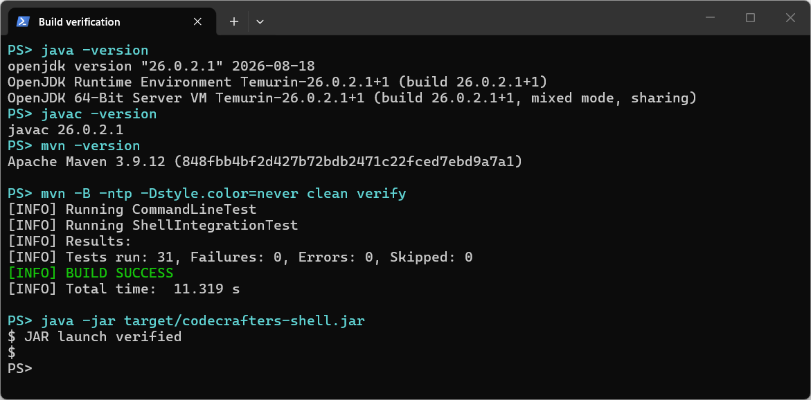
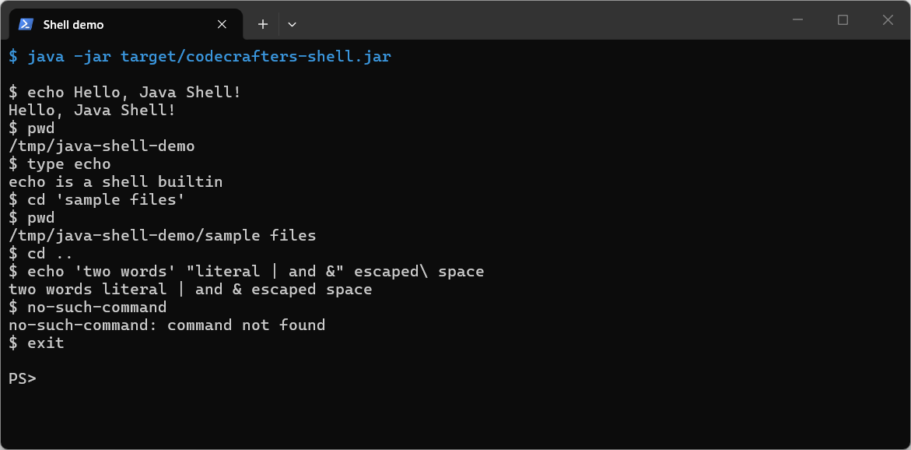
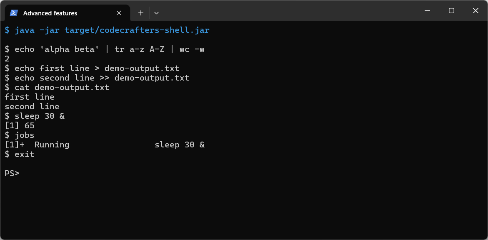

# Java Shell

A Unix-style shell written in Java for the CodeCrafters
[Build Your Own Shell](https://app.codecrafters.io/courses/shell/overview) challenge.
It implements a command loop, built-ins, external programs, pipelines, output
redirection, and basic background jobs.

## Build and run

Use JDK 26 and Apache Maven. The launcher also needs a POSIX shell.
From the repository root, build and run the executable JAR.

```sh
mvn clean verify
java -jar target/codecrafters-shell.jar
```

On a Unix-like system, `./your_program.sh` builds the JAR and launches it in
the calling directory. The launcher skips test execution. Run `mvn test` to
run the parser unit tests and child-process integration tests separately.

CodeCrafters uses `.codecrafters/compile.sh` followed by `.codecrafters/run.sh`
with the `java-26` buildpack in `codecrafters.yml`. The compile script writes
the JAR to `/tmp/codecrafters-build-shell-java`.

## Commands and syntax

| Built-in | Behavior |
| --- | --- |
| `echo [args...]` | Prints the arguments separated by one space. |
| `pwd` | Prints the shell's current directory. |
| `cd [path]` | Changes directory. With no path or with `~`, it uses `HOME`, falling back to Java's user home. |
| `type name` | Reports a built-in or the executable found in `PATH`. |
| `jobs` | Lists running background jobs and reports any completed jobs since the preceding check. |
| `exit` | Exits the shell. End-of-file also exits. |

External commands can use an explicit path or a name found in `PATH`. Child
processes, relative `PATH` entries, and relative redirection targets use the
shell's current directory.

Single quotes preserve literal text. Double quotes keep spaces and support
backslash escapes for double quotes, backslashes, dollar signs, and backticks.
Outside quotes a backslash escapes the next character. Adjacent quoted and
unquoted fragments form one argument, and empty quotes produce an empty
argument. Quoted and escaped operators are argument text. Blank input displays
another prompt. Malformed input produces a diagnostic and returns to the prompt.

| Operator | Behavior |
| --- | --- |
| `>` or `1>` | Writes stdout to a file, replacing existing content. |
| `>>` or `1>>` | Appends stdout to a file. |
| `2>` | Writes stderr to a file, replacing existing content. |
| `2>>` | Appends stderr to a file. |
| `\|` | Connects one stage's stdout to the next stage's stdin. |
| `&` | Runs the command or pipeline in the background when placed at the end. |

Redirections apply to individual pipeline stages. Redirecting a stage's
stdout sends its output to the file and the next stage receives EOF. Missing
parent directories are created for output redirection, as in the original
project. A foreground external command or first pipeline stage can read the
shell's input. Background jobs start with closed stdin.

```sh
echo 'literal | and &' a\ b
echo first > "logs/run log"
echo second >> "logs/run log"
ls missing 2> logs/errors
echo hello | tr a-z A-Z | wc -c
sleep 10 | cat &
jobs
```

Job completion is checked at prompts and by `jobs`. A pipeline remains active
until all its stages finish. A background built-in runs with isolated shell
state and has a job number without an OS process ID. A pipeline's `cd` or `exit`
applies only to that stage. On exit or EOF the shell stops tracked children
and attempts to stop descendants that are still visible.

The supported syntax covers the features above. History, tab completion,
substitutions, globbing, input redirection, descriptor duplication, and terminal
job control are outside the current implementation.

## Demonstration

### Build and test verification



The Windows build runs the parser and integration suites, packages the JAR, and launches it from PowerShell.

### Built-ins, navigation, and quoting



The shell changes into a directory with spaces in its name, preserves quoted operators as text, and returns to the prompt after an invalid command.

### Pipelines, redirection, and jobs



The Linux session counts words through a three-stage pipeline, writes and appends lines to a file, and reports a running background job with `jobs`.

## Testing

Run `mvn clean verify` to execute the tests and build the runnable JAR.
The build passed on Windows 11 with Eclipse Temurin 26.0.2.1 and Apache
Maven 3.9.12.

| Test suite | Passed | Failed | Errors | Skipped |
| --- | ---: | ---: | ---: | ---: |
| Parser unit tests | 18 | 0 | 0 | 0 |
| Shell integration tests | 13 | 0 | 0 | 0 |
| **Total** | **31** | **0** | **0** | **0** |

The tests cover quoting, escapes, built-ins, external commands, directory
navigation, redirection, pipelines, background jobs, and EOF. The integration
tests launch the shell and real child processes.

## Source layout

- `Main.java` and `Shell.java` handle the command loop, working directory, and
  built-in commands.
- `CommandLine.java` parses commands, quoting, and operators.
- `Executables.java` resolves explicit paths and searches `PATH`.
- `Pipeline.java` and `RedirectFiles.java` launch commands, connect streams, and
  manage redirection files.
- `Jobs.java` tracks background pipelines and reports completion.
- `src/test/java` contains parser tests and integration tests that launch the
  shell and real child processes.

## Acknowledgements

This project was developed by **J. Darshan** as part of the
[Build Your Own Shell](https://app.codecrafters.io/courses/shell/overview)
challenge by CodeCrafters.

[](https://app.codecrafters.io/users/darshan1117?r=2qF)

[GitHub](https://github.com/Darshan-J-07) |
[LinkedIn](https://www.linkedin.com/in/darshan-j07)
